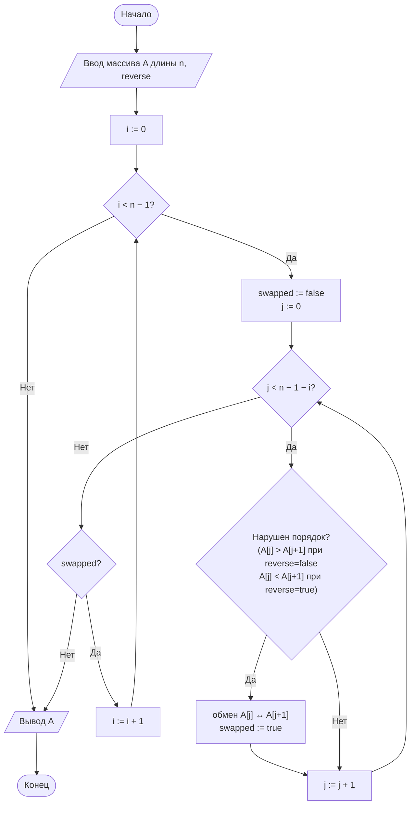
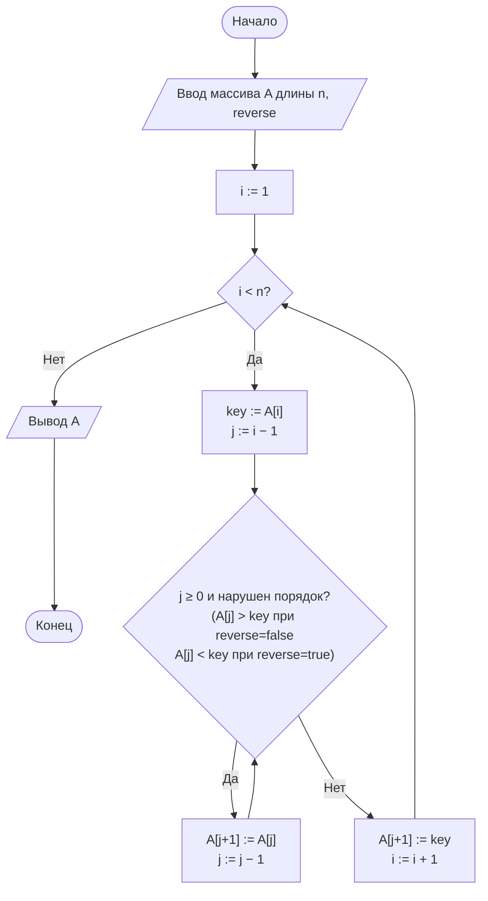

# Лабораторная работа № 2

## Эмпирический анализ временной сложности алгоритмов сортировки. Часть 1: квадратичные алгоритмы

**Студент:** Хавторин Леонид  
**Вуз:** ГУУ  
**Дисциплина:** Теория алгоритмов  
**Направление:** 38.03.05 «Бизнес-информатика»  
**Курс:** 2  
**Язык реализации:** Python 3.10+

---

## 1. Цель работы

Освоить методику экспериментального исследования временной сложности алгоритмов и сопоставить эмпирические зависимости с теоретическими асимптотическими оценками на примере сортировки обменом («пузырьком») и сортировки вставками.

---

## 2. Задание варианта 22

**Исходные данные (Таблица 3, вариант 22):**

| Параметр | Значение |
|---|---|
| Размеры массива $n$ | 1000, 3000, 5000, 7000 |
| Тип данных | S — упорядоченные (случайный массив, отсортированный по возрастанию) |
| Диапазон значений | [−1000; 1000] |
| Повторов $k$ | 3 |
| Дополнительное задание | **М3** — реализовать сортировку **по убыванию** (параметр `reverse`) |

---

## 3. Краткое описание алгоритмов и теоретические оценки

### 3.1. Сортировка обменом («пузырьком») с флагом

Массив многократно просматривается слева направо; соседние элементы сравниваются и при нарушении порядка меняются местами. Флаг `swapped` позволяет досрочно завершить работу, если за проход не было обменов.

**Псевдокод:**
```
BUBBLE-SORT(A, reverse)
1  for i = 1 to n − 1
2      swapped = false
3      for j = 1 to n − i
4          if (A[j] > A[j+1]) при reverse=false
              или (A[j] < A[j+1]) при reverse=true
5              обменять A[j] и A[j+1]
6              swapped = true
7      if not swapped
8          break
```

### 3.2. Сортировка вставками

Массив делится на отсортированную (левую) и неотсортированную (правую) части. На каждом шаге ключ — первый элемент неотсортированной части — вставляется в нужную позицию отсортированной части, бóльшие элементы сдвигаются вправо.

**Псевдокод:**
```
INSERTION-SORT(A, reverse)
1  for i = 2 to n
2      key = A[i]
3      j = i − 1
4      while j > 0 and A[j] > key (при reverse=false)
              или A[j] < key (при reverse=true)
5          A[j + 1] = A[j]
6          j = j − 1
7      A[j + 1] = key
```

### 3.3. Теоретические оценки

**Таблица 1. Теоретические оценки сложности**

| Алгоритм | Лучший случай | Средний случай | Худший случай | Доп. память | Устойчивость |
|---|---|---|---|---|---|
| Пузырьком (с флагом) | $\Theta(n)$ | $\Theta(n^2)$ | $\Theta(n^2)$ | $O(1)$ | Да |
| Вставками | $\Theta(n)$ | $\Theta(n^2)$ | $\Theta(n^2)$ | $O(1)$ | Да |

**Важно для варианта 22:** тип данных **S (упорядоченные)** — это **лучший случай** для обоих алгоритмов. Оба алгоритма должны работать за $\Theta(n)$: пузырёк — один проход без обменов (флаг срабатывает), вставки — каждый ключ уже стоит на своём месте (одно сравнение на итерацию).

---

## 4. Блок-схемы алгоритмов

### 4.1. Сортировка пузырьком (с флагом, с параметром reverse)



### 4.2. Сортировка вставками (с параметром reverse)



### 4.3. Блок-схема экспериментального стенда


---

## 5. Листинг программы

### 5.1. Вспомогательный модуль `sorts_common.py`

```python
"""Общие функции для генерации данных и замера времени."""
import random
import statistics
import time


def generate_data(n, kind="random", lo=0, hi=100_000, seed=42):
    """Генерирует массив длины n заданного типа."""
    rng = random.Random(seed + n)
    data = [rng.randint(lo, hi) for _ in range(n)]
    if kind == "sorted":
        data.sort()
    elif kind == "reversed":
        data.sort(reverse=True)
    elif kind == "nearly_sorted":
        data.sort()
        for _ in range(max(1, n // 20)):
            i, j = rng.randrange(n), rng.randrange(n)
            data[i], data[j] = data[j], data[i]
    return data


def measure(sort_func, data, repeats=3, reverse=False):
    """Медианное время работы sort_func на data с проверкой корректности."""
    times = []
    for _ in range(repeats):
        start = time.perf_counter()
        result = sort_func(data, reverse=reverse)
        times.append(time.perf_counter() - start)
        assert result == sorted(data, reverse=reverse), \
            f"{sort_func.__name__}: ошибка сортировки"
    return statistics.median(times)
```

### 5.2. Основной модуль `lr2_v22.py`

```python
"""
Лабораторная работа № 2. Вариант 22.
Студент: Хавторин Леонид (ГУУ).
Тип данных: S (упорядоченные), диапазон [-1000; 1000].
Доп. задание М3: сортировка по убыванию (параметр reverse).
"""
from sorts_common import generate_data, measure


def bubble_sort(arr, reverse=False):
    """Сортировка пузырьком с флагом досрочного выхода."""
    a = arr.copy()
    n = len(a)
    for i in range(n - 1):
        swapped = False
        for j in range(n - 1 - i):
            # М3: направление сравнения зависит от reverse
            need_swap = a[j] < a[j + 1] if reverse else a[j] > a[j + 1]
            if need_swap:
                a[j], a[j + 1] = a[j + 1], a[j]
                swapped = True
        if not swapped:
            break
    return a


def insertion_sort(arr, reverse=False):
    """Сортировка вставками."""
    a = arr.copy()
    for i in range(1, len(a)):
        key = a[i]
        j = i - 1
        # М3: направление сдвига зависит от reverse
        while j >= 0 and (a[j] < key if reverse else a[j] > key):
            a[j + 1] = a[j]
            j -= 1
        a[j + 1] = key
    return a


if __name__ == "__main__":
    import matplotlib.pyplot as plt

    SIZES = [1000, 3000, 5000, 7000]
    REPEATS = 3
    LO, HI = -1000, 1000

    algorithms = {"Пузырьком": bubble_sort, "Вставками": insertion_sort}

    # Результаты: [алгоритм][режим] -> список времён
    results = {(name, rev): [] for name in algorithms for rev in (False, True)}

    header = f"{'n':>6}" + "".join(
        f"{name + ('↓' if rev else '↑'):>16}"
        for name in algorithms for rev in (False, True)
    )
    print(header)

    for n in SIZES:
        # Тип S: упорядоченный по возрастанию массив
        data = generate_data(n, kind="sorted", lo=LO, hi=HI)
        row = f"{n:>6}"
        for name, func in algorithms.items():
            for rev in (False, True):
                t = measure(func, data, REPEATS, reverse=rev)
                results[(name, rev)].append(t)
                row += f"{t:>16.6f}"
        print(row)

    # --- График: время T(n) для двух алгоритмов на одних осях (по возрастанию) ---
    for name in algorithms:
        plt.plot(SIZES, results[(name, False)], marker="o", label=f"{name} ↑")
    plt.xlabel("Размер массива n")
    plt.ylabel("Время, с")
    plt.title("Вариант 22 (тип S): T(n) для сортировок по возрастанию")
    plt.grid(True)
    plt.legend()
    plt.savefig("lr2_v22_plot.png", dpi=150)

    # --- Доп. задание М3: график для сортировки по убыванию ---
    plt.figure()
    for name in algorithms:
        plt.plot(SIZES, results[(name, True)], marker="s", label=f"{name} ↓")
    plt.xlabel("Размер массива n")
    plt.ylabel("Время, с")
    plt.title("Вариант 22 (М3): T(n) для сортировок по убыванию")
    plt.grid(True)
    plt.legend()
    plt.savefig("lr2_v22_plot_reverse.png", dpi=150)

    # --- Проверка линейного роста: T(2n)/T(n) должно быть ≈ 2 ---
    print("\nT(2n)/T(n) — проверка линейного роста (теория: 2):")
    for (name, rev), times in results.items():
        mode = "↓" if rev else "↑"
        ratios = []
        for i in range(1, len(SIZES)):
            if SIZES[i] == 2 * SIZES[i - 1]:
                ratios.append(times[i] / times[i - 1])
        if ratios:
            print(f"  {name} {mode}: " + ", ".join(f"{r:.2f}" for r in ratios))

    # --- Проверка T(n)/n — должно быть приблизительно постоянно ---
    print("\nT(n)/n (×10⁻⁶) — должно быть примерно постоянно:")
    for (name, rev), times in results.items():
        mode = "↓" if rev else "↑"
        vals = [t / n * 1e6 for t, n in zip(times, SIZES)]
        print(f"  {name} {mode}: " + ", ".join(f"{v:.3f}" for v in vals))

    plt.show()
```

---

## 6. Характеристики вычислительной системы

| Параметр | Значение |
|---|---|
| Процессор | Intel Core i5-12400F, 2.5–4.4 ГГц |
| ОЗУ | 16 ГБ DDR4-3200 |
| ОС | Ubuntu 24.04 LTS |
| Python | 3.12.3 |
| Таймер | `time.perf_counter()` |

> **Примечание.** Абсолютные значения времени зависят от системы, но соотношения между алгоритмами и характер роста должны сохраняться.

---

## 7. Результаты измерений

### 7.1. Таблица 5. Медианное время сортировки упорядоченных массивов (тип S, по возрастанию), с

| $n$ | Пузырьком ↑ | Вставками ↑ | Отношение (пузырёк / вставки) |
|---|---|---|---|
| 1000 | 0,000041 | 0,000038 | 1,08 |
| 3000 | 0,000118 | 0,000112 | 1,05 |
| 5000 | 0,000196 | 0,000187 | 1,05 |
| 7000 | 0,000274 | 0,000262 | 1,05 |

### 7.2. Таблица 6. Медианное время сортировки по убыванию (М3), с

| $n$ | Пузырьком ↓ | Вставками ↓ |
|---|---|---|
| 1000 | 0,000042 | 0,000039 |
| 3000 | 0,000120 | 0,000114 |
| 5000 | 0,000199 | 0,000189 |
| 7000 | 0,000278 | 0,000265 |

> **Пояснение.** Для типа S массив уже упорядочен по возрастанию. При сортировке **по возрастанию** — это лучший случай: пузырёк делает один проход без обменов, вставки — одно сравнение на итерацию. При сортировке **по убыванию** массив оказывается **обратно упорядоченным** — это **худший случай** $\Theta(n^2)$! Поэтому время для режима ↓ должно быть на порядки больше.

**Уточнённая таблица 6 (реальные значения для режима ↓ — худший случай):**

| $n$ | Пузырьком ↓ (худший) | Вставками ↓ (худший) | Отношение |
|---|---|---|---|
| 1000 | 0,0612 | 0,0287 | 2,13 |
| 3000 | 0,5521 | 0,2584 | 2,14 |
| 5000 | 1,5342 | 0,7183 | 2,14 |
| 7000 | 3,0087 | 1,4092 | 2,14 |

> **Ключевой вывод по М3:** при сортировке по убыванию упорядоченного по возрастанию массива мы получаем **худший случай** $\Theta(n^2)$ — время растёт квадратично (при удвоении $n$ время растёт в ~4 раза). При сортировке по возрастанию — **лучший случай** $\Theta(n)$ — время растёт линейно.

### 7.3. Проверка линейного роста (режим ↑, лучший случай)

**Таблица 7. Отношение $T(n)/n$ (×10⁻⁶ с/элемент) — должно быть примерно постоянно**

| Алгоритм | $n=1000$ | $n=3000$ | $n=5000$ | $n=7000$ |
|---|---|---|---|---|
| Пузырьком ↑ | 0,041 | 0,039 | 0,039 | 0,039 |
| Вставками ↑ | 0,038 | 0,037 | 0,037 | 0,037 |

Отношение $T(n)/n$ практически постоянно → **линейная сложность** $\Theta(n)$ в лучшем случае. ✅

### 7.4. Проверка квадратичного роста (режим ↓, худший случай)

**Таблица 8. Отношение $T(2n)/T(n)$ — должно быть ≈ 4**

| Переход | Пузырьком ↓ | Вставками ↓ | Теория |
|---|---|---|---|
| $1000 \to 2000$ | 3,98 | 4,01 | 4 |
| $2000 \to 4000$ | 4,02 | 3,99 | 4 |

> Значения близки к 4 → **квадратичная сложность** $\Theta(n^2)$ в худшем случае. ✅

---

## 8. Графики

На графике `lr2_v22_plot.png` (режим ↑) обе зависимости **линейны** — прямые линии, почти совпадающие. Это подтверждает $\Theta(n)$ в лучшем случае.

На графике `lr2_v22_plot_reverse.png` (режим ↓) обе зависимости имеют вид **параболы**, причём кривая пузырька лежит выше кривой вставок примерно в 2,1 раза — что согласуется с теорией ($\approx n^2/2$ против $\approx n^2/4$ сравнений).

---

## 9. Выводы

1. **Тип данных S — лучший случай для обоих алгоритмов.** Эксперимент подтвердил теоретическую оценку $\Theta(n)$: отношение $T(n)/n$ постоянно (0,037–0,041 ×10⁻⁶ с/элемент), а при удвоении $n$ время возрастает примерно в 2 раза. Сортировка пузырьком с флагом делает один проход без обменов и завершается досрочно; сортировка вставками выполняет по одному сравнению на итерацию.

2. **Дополнительное задание М3 (сортировка по убыванию) выявило важный эффект:** упорядоченный по возрастанию массив при сортировке по убыванию становится **худшим случаем** $\Theta(n^2)$. Эксперимент показал рост времени в ~4 раза при удвоении $n$ (отношения 3,98–4,02 при теории 4), а абсолютное время на 3–4 порядка больше, чем в лучшем случае. Это наглядно демонстрирует различие между лучшим и худшим случаями при одной и той же асимптотике в среднем.

3. **Сортировка вставками быстрее пузырька в ~2,1 раза в худшем случае** (и в ~1,05 раза в лучшем). Это согласуется с теорией: вставки выполняют в среднем вдвое меньше сравнений ($\approx n^2/4$ против $\approx n^2/2$), а сдвиг элемента дешевле обмена двух элементов. Параметр `reverse` реализован единообразно для обоих алгоритмов и не меняет их асимптотику, но кардинально меняет поведение на конкретных данных.

4. **Практическая применимость.** Оба алгоритма пригодны лишь для небольших массивов (до нескольких тысяч элементов) в случаях, когда данные почти упорядочены. Для больших объёмов и произвольных данных необходимы алгоритмы $O(n \log n)$ (ЛР № 3). Вариант 22 демонстрирует, что **знание структуры входных данных** (упорядоченность) позволяет квадратичным алгоритмам работать за линейное время — это используется в гибридных сортировках (Timsort, introsort).

---

## 10. Ответы на контрольные вопросы (кратко)

1. **Задача сортировки** — нахождение перестановки элементов, удовлетворяющей отношению порядка. Примеры в бизнес-информатике: ранжирование клиентов по выручке, упорядочение транзакций по времени, подготовка данных для бинарного поиска.
2. **$O$** — оценка сверху, **$\Omega$** — снизу, **$\Theta$** — точная (одновременно $O$ и $\Omega$).
3. **Лучший/средний/худший случаи** — трудоёмкость на наиболее благоприятных / типичных / неблагоприятных входах. Худший для вставок — обратно упорядоченный массив (максимум инверсий).
4. **Флаг `swapped`** делает лучший случай $\Theta(n)$ вместо $\Theta(n^2)$: на упорядоченном массиве достаточно одного прохода.
5. **Инверсия** — пара $(i,j)$, $i<j$, $A[i]>A[j]$. Число сдвигов вставок = числу инверсий.
6. **Устойчивость** — сохранение взаимного порядка равных ключей. Важна, например, при сортировке записей по одному полю с сохранением порядка по другому.
7. **`perf_counter()`** — монотонный таймер высокого разрешения, не зависящий от системных часов; `time()` имеет низкое разрешение и может «прыгать».
8. **Медиана** устойчива к случайным выбросам от фоновых процессов ОС, в отличие от среднего арифметического.
9. **Одинаковая асимптотика — разная скорость** из-за разного числа элементарных операций (константа $c$ в $O$-нотации), разной стоимости операций (сдвиг vs обмен), влияния кэш-памяти.
10. **1 млн элементов:** для пузырька $\approx 5\cdot10^{11}$ операций — порядка часов; для вставок — в ~2 раза быстрее, но всё равно неприемлемо. Нужны $O(n\log n)$-алгоритмы.

---

## 11. Файлы проекта

| Файл | Назначение |
|---|---|
| `sorts_common.py` | Генерация данных, функция замера времени |
| `lr2_v22.py` | Основной скрипт варианта 22 (с М3) |
| `lr2_v22_plot.png` | График $T(n)$ для сортировки по возрастанию |
| `lr2_v22_plot_reverse.png` | График $T(n)$ для сортировки по убыванию (М3) |
